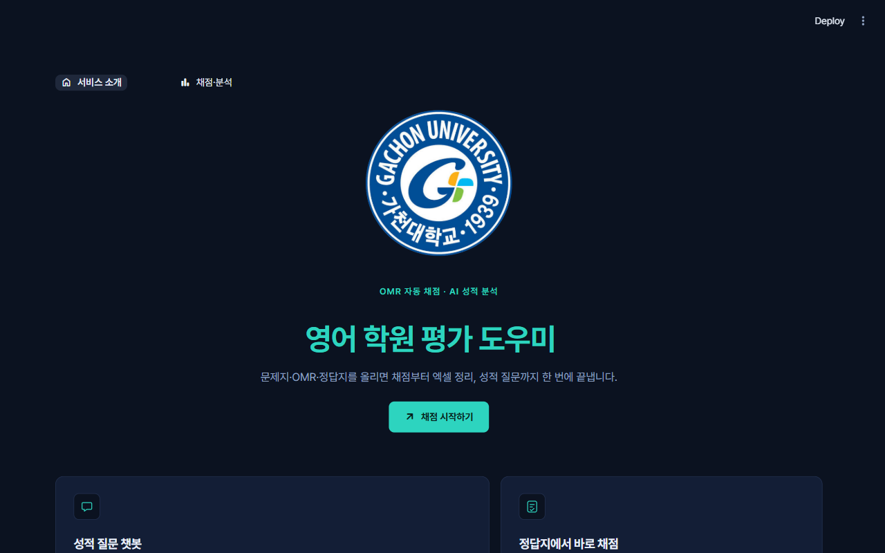
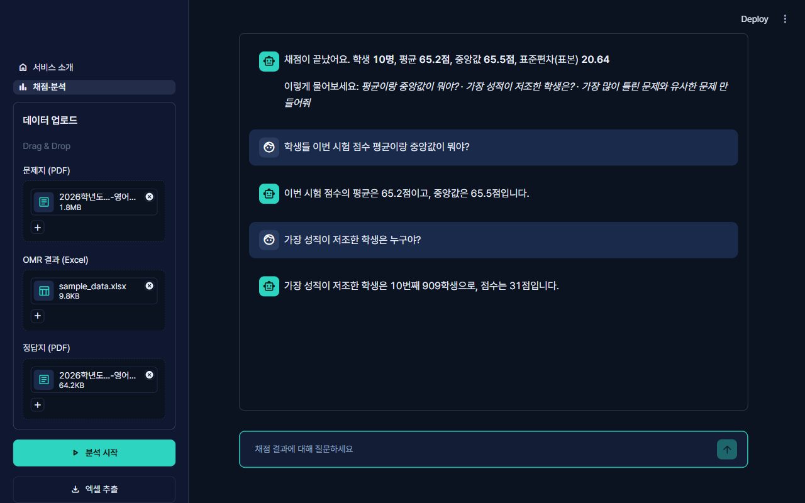
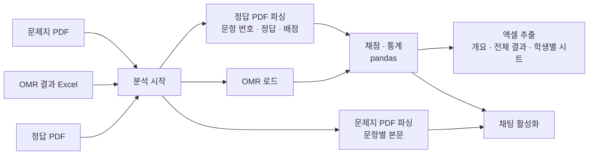
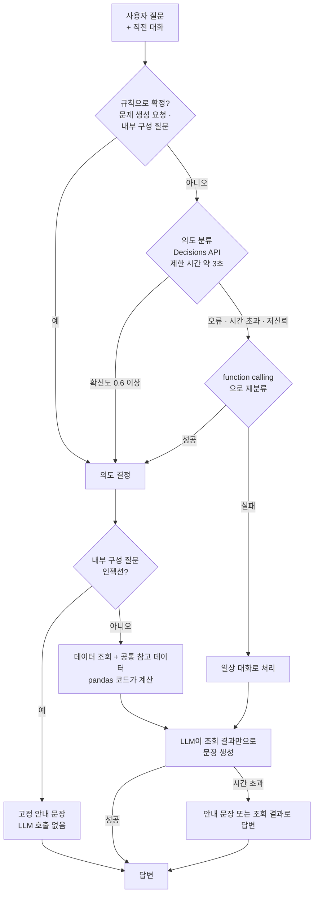

# 영어 학원 평가 도우미 (OMR 자동 채점 + 성적 분석 챗봇)

가천대 부트캠프 AI Agent 개발 최종 평가 과제.

| 항목 | 내용 |
|---|---|
| 학번 / 이름 | 202235127 / 조예준 |
| 배포 URL | **(배포 후 작성)** |

영어 학원 원장님이 **문제지 PDF · OMR 결과(엑셀) · 정답 PDF**를 올리면 자동으로 채점하고, 결과를 **엑셀로 내려받고**,
채점 결과에 대해 **챗봇으로 질문**(통계, 학생 점수, 가장 많이 틀린 문항, 유사 문제 생성)할 수 있는 웹 서비스입니다.

## 화면

| 1페이지 (소개) | 2페이지 (채점·분석) |
|---|---|
|  |  |

## 요구사항 대응

| # | 요구사항 | 구현 |
|---|---|---|
| 1 | 2페이지 웹 + 배포 | `app.py`(랜딩), `pages/analysis.py`(데이터 입력·분석). Streamlit Community Cloud 배포 |
| 2 | 자동 채점 | 사이드바에서 업로드 → **분석 시작**. 정답·배점은 **업로드한 정답 PDF에서 파싱**(코드/별도 파일 하드코딩 없음) |
| 3 | 엑셀 추출 | 전체 개요(평균·중앙값·표준편차·가장 많이 틀린 문항 3개), 전체 학생 결과, `N번 학생 점수 및 각 문제별 정답 여부` 시트 |
| 4 | 채팅 | 채점 후 활성화. 세션 내 이전 대화를 기억(DB 저장 없음), 일상 질문 응답 |
| 5 | 채팅 세부 | 통계, 유사 문제 생성, 최저 성적 학생, 학생 점수, 데이터에 없는 질문 회피, 프롬프트 인젝션 방어 |

## 구조

```
app.py               랜딩 페이지
pages/analysis.py    업로드 · 채점 · 엑셀 · 채팅
core/answer_key.py   정답 PDF → {문항: (정답, 배점)}
core/problems.py     문제지 PDF → {문항: 본문}  (2단 편집 대응)
core/grading.py      채점 · 통계 (pandas)
core/export.py       엑셀 생성
core/chat.py         질문 분류 → 데이터 조회 → 답변 생성
tests/               파서·채점·엑셀·학생 지칭 테스트
scripts/scenario.py  평가 질문 시나리오를 실제 API로 점검하는 수동 스크립트
docs/                설계 문서
```

## 챗봇 동작 방식

### 전체 파이프라인



### 챗봇 응답 흐름



의도는 8가지입니다. `summary_stats`(평균·중앙값·표준편차), `lowest_student`, `student_score`, `hardest_questions`, `generate_similar_problem`, `out_of_scope`(데이터에 없는 정보), `meta_or_injection`, `chitchat`.

- **숫자는 LLM이 계산하지 않습니다.** 평균·중앙값·점수·오답 순위는 pandas로 계산하고, LLM은 조회 결과를 문장으로 옮기기만 합니다.
- **데이터에 없는 질문**(예: "13번 학생 어제 수업 참여했어?")은 "채점 데이터에 없어 알 수 없다"고 답합니다.
- **내부 구성을 묻는 질문/프롬프트 인젝션**(예: "어떤 Tool 연결되어있어?")은 LLM에 도달하기 전에 고정 문장으로 답하고 지원 기능만 안내합니다.
- **분류기가 바뀌어도 안전하게**: "문제 만들어 줘" 같은 문제 생성 요청과 내부 구성 질문은 모델 호출 없이 **규칙으로 먼저** 라우팅합니다(0초). Decisions API는 베타라 평가 시점에 동작이 바뀌거나 막힐 수 있기 때문입니다.
- **복합·변형 질문 대응**: 어떤 의도로 분류돼도 요약 통계, 최저·상위 학생, 점수 구간별 인원, 문항별 오답 수·오답률을 **공통 참고 데이터**로 함께 넘겨서 "평균이랑 꼴찌 둘 다", "90점 이상 몇 명", "21번 정답률"에도 답합니다.
- **20초 제한**: 전체 예산 17초 안에서 단계별 타임아웃을 두고, LLM이 실패하면 사람이 읽는 안내 문장(또는 조회 결과)으로 답합니다. 내부 지시문은 노출되지 않습니다. 실측 응답은 약 0~5초(Decisions API 실패 후 대체 경로 포함 최대 8초).

## 기술 선택과 이유

| 결정 | 선택 | 이유 |
|---|---|---|
| 언어 | Python | pandas, PDF 파싱, 엑셀, OpenAI SDK를 모두 바로 쓸 수 있음 |
| 웹 | Streamlit (멀티페이지) | 사이드바 업로더, 채팅 입력, 다운로드 버튼이 기본 제공. 직접 프론트엔드를 만들 이유가 없음 |
| 배포 | Streamlit Community Cloud | GitHub 연결만으로 무료 배포, API 키는 Secrets로 관리해 저장소에 노출되지 않음 |
| **LangChain** | **사용하지 않음** | 이 서비스의 LLM 호출은 "분류 1회 + 문장 생성 1회"뿐이라 체인·추상화가 필요 없다. OpenAI SDK를 직접 호출하는 편이 더 짧고, 의존성이 늘면 배포 오류·지연·디버깅 비용만 커진다. 대화 기억도 메시지 리스트 하나로 충분하다. |
| **LangGraph** | **사용하지 않음** | 흐름이 `분류 → 조회 → 답변`의 직선 하나다. 상태 그래프·루프·병렬 분기가 없어 그래프로 표현할 이득이 없고, 노드가 늘수록 LLM 호출이 늘어 20초 제한에 불리하다. |
| **자율 에이전트 루프** | **사용하지 않음** | 도구는 고정된 몇 개의 함수다. 모델이 계획을 세워 반복 호출하는 방식은 느리고 비결정적이라 "부분점수 없음 + 20초 제한" 평가에 오히려 위험하다. 대신 분류(라우터)와 코드 도구를 직접 구현했다. |
| 질문 분류 | **OpenAI Decisions API** → 실패 시 function calling | 선택지 분류에 특화된 엔드포인트라 약 1초로 빠르다. 단, 공개 베타라 단독 의존하지 않고 에러·타임아웃·낮은 확신도(0.6 미만)면 function calling으로 자동 대체한다. 두 경로 모두 실제 호출로 검증했다. |
| 숫자 계산 | pandas (코드) | LLM의 암산 오류를 원천 차단 |
| 답변 모델 | `gpt-4.1-mini` | 추론 모델이 아니라 응답이 2~3초로 빠르다. 환경변수 `CHAT_MODEL`로 교체 가능 |
| 정답 추출 | pdfplumber + 정규식 | 정답 PDF가 `번호 정답 배점` 패턴이라 정규식 하나로 충분. 문항이 1..N 연속이 아니면 오류로 알린다 |
| 문제지 추출 | pdfplumber, 좌/우 단 분리 | 2단 편집이라 페이지 전체를 읽으면 두 단이 섞이므로 절반씩 잘라 읽고, 다음 번호(`N+1.`)만 문항 시작으로 인정해 본문 속 숫자 오탐을 막는다 |

## 해석이 필요했던 부분 (판단 기록)

- **"87번 학생"**: 샘플 학생명이 `900학생`~`909학생`이라 모호하다. 학생명 속 숫자가 일치하면 그 학생, 없으면 데이터 순서의 N번째 학생으로 해석하고 답변에 학생명을 함께 표기한다.
- **표준편차**: pandas 기본인 표본 표준편차(ddof=1)를 쓰고 라벨에 `(표본)`을 표시했다.
- **동점 처리**: 가장 많이 틀린 문항은 "오답 수 → 배점 높은 순 → 문항 번호 순"으로, 최저 성적 학생은 동점이면 모두 알려준다.
- **듣기 문항(1~17번)**: 문제지 PDF에 대본이 없어 발문·선택지만 읽힌다. 이 문항이 최다 오답이면 대본까지 새로 생성해 유사 문제를 만든다.
- **빈칸/이상 마킹**: 오답으로 처리하고, 몇 칸이었는지 화면 경고와 엑셀 개요 시트에 표시한다. 원문자(①~⑤)는 1~5로 읽는다.
- **OMR 파일 형식**: 문항 열 이름은 `Q01`, `q1`, `1`, `1번`, `문항1`을 허용하고, 시트가 여러 개면 문항 열이 가장 많은 시트를, 학생명은 `학생명/이름/성명` 열을 우선 사용한다(없으면 문항이 아닌 첫 열). 중복된 학생명은 `이름(2)`처럼 구분하고, 너무 긴 이름은 40자로 줄인다.
- **학생 번호**: 채팅은 학생명 속 숫자를 먼저, 없으면 데이터 순서를 쓰고 답변에 `N번째 · 학생명`을 함께 적는다. 엑셀의 `N번 학생` 시트는 데이터 순서이며 시트 안과 `전체 학생 결과` 시트(번호 열)에 학생명이 있다.
- **TOP3 경계 동점**: 3위와 오답 수가 같은 문항이 더 있으면 엑셀 개요 시트와 챗봇 참고 데이터에 따로 표시한다.
- **파일 교체 안내**: 업로드 파일을 바꿨는데 다시 분석하지 않으면 "이전 파일 기준"이라는 안내를 띄운다.
- **엑셀**: 요구사항 그림대로 학생별 시트를 만들고, 한눈에 보기 위한 `전체 학생 결과` 시트를 추가했다.

## 로컬 실행

```bash
pip install -r requirements.txt
echo OPENAI_API_KEY=sk-... > .env      # 키는 커밋하지 않음(.gitignore)
streamlit run app.py
python -m pytest -q                    # 테스트
python -X utf8 scripts/scenario.py     # 평가 질문 시나리오(실제 API 호출)
```

## 배포 (Streamlit Community Cloud)

1. https://share.streamlit.io 에서 이 저장소의 `app.py`를 선택해 배포
2. App settings → Secrets에 `OPENAI_API_KEY = "sk-..."` 추가
3. 제출 전에 한 번 접속해 앱을 깨워 둔다. (Community Cloud는 일정 기간 접속이 없으면 앱이 잠들며 첫 접속에 수십 초가 걸릴 수 있다)

## 한계

- 평가용 120명 데이터는 개발용 10명 샘플과 같은 형식이라고 가정했다.
- Decisions API는 공개 베타라 동작이 바뀔 수 있다. 그래서 function calling 대체 경로를 항상 둔다.
- 대화 내역은 DB에 저장하지 않으므로 새로고침하면 사라진다(요구사항).
